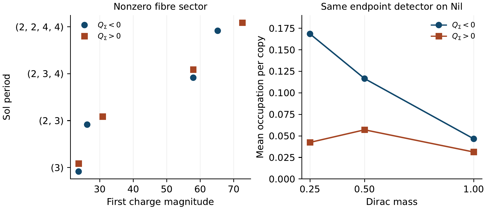

# 第6節　エネルギーと時間発展から電荷の符号を読む

## 6.1　球面商における各電荷枝の瞬時エネルギー

半径 $`q`$ の丸い空間断面で、 $`X=|Q_\Sigma|q/(4\mathcal V)`$ とおく。外部 Dirac 粒子を1種取り、両電荷枝で同一の局所減算を行い、固有値が厳密に零となる準位の占有数を $`1/2`$ とする。 $`Q=|Q_\Sigma|`$ とすると、無次元の真空エネルギー差 $`D=q(E_{\rm vac}(+Q)-E_{\rm vac}(-Q))`$ は、最初の殻に達するまで $`D=2X\eta_0`$ に従う。最初の殻と次の殻の間では

$$
 D=2X\eta_0-2\delta_0(X-3/2),\qquad
 \delta_0=m_+(0)-m_-(0),\qquad 3/2\lt X\lt 5/2 .
 \tag{8}
$$

電荷の符号を $`s`$ とすると、各固有値からその枝のエネルギーへの寄与は $`-|\lambda-sX|`$ に比例する。最低準位を通過すると差の傾きは $`-2\delta_0`$ だけ変化し、絶対値がそれより大きい固有値はすべて零の元の側に留まる。η 正則化から共通の初期傾き $`2\eta_0`$ が得られる。したがって、このエネルギー差の零点は、各枝で独立に準備した二つの瞬時真空のエネルギーが一致する点である。空間作用素が零固有値をもつ条件や、固定した初期状態から測る占有数とは区別される。

左から作用する位数3の商では、最初の接触までの傾きは $`8/9`$ で、次に差が零になるのは $`X=27/14`$ である。丸いレンズ空間の任意のスピンリフトを考えると、上の開区間に孤立零点をもつのは、位数2、3、4の巡回群が片側から作用する場合に限る。零点はそれぞれ $`12/7,\ 27/14,\ 24/11`$ にある。位数5の片側作用では端点 $`5/2`$ が零点となる。[付録G](DPPUv8-paper08_appG.md)で任意の位数に対してこの分類を導出する。位数32までの有限列挙でも、全434個のスピンリフトについて独立に確かめた。最小結合の丸いローレンツ時空の時間発展では $`X\ge 3/2`$ で、等号が成り立つのは半径が最大となるときだけである。エネルギーの式が形式的に成り立つ区間と併せて、実際に到達する半径の範囲を指定する必要がある。

**質量ゼロの場合との対照**

最小結合の丸い背景 $`q^2=c\sin(2v)`$ で、 $`\chi=\pm1`$ をカイラリティ、 $`\xi_\alpha`$ を粒子種 $`\alpha`$ の軸性結合とする。共形時間における殻の時間発展の生成子は $`\chi(\lambda-s\xi_\alpha b)`$ で、 $`b=3/(2\sin 2v)`$ である。 $`\pi/12\le v\le\pi/6`$ 上の発展は

$$
 U_s=\exp\!\left[\frac{i s\beta}{2}\sum_\alpha \xi_\alpha Q_{5,\alpha}\right]U_{\mathrm{LC}},
 \qquad
 \beta=\frac{3}{2}\log\!\left(\frac{\tan v_f}{\tan v_i}\right)
$$

と因子化される。単一種で同じ状態を準備すれば、その軸電荷と可換な観測量の代数上で、両枝の期待値は一致する。二種の軸性結合を個別に指定すると、この位相は相対位相として測れる。左から作用する位数3の商では、 $`+9/2`$ と $`-11/2`$ の殻は右作用のスピン $`2`$ を共有する。商を取った後も残る左のウェイト $`m=\pm3/2`$ を選び、一方の殻の粒子と他方の殻の正孔を組にして、等しい右のウェイト同士を縮約する。係数を $`\mathrm{sgn}\thinspace m`$ に比例させると、残った鏡映作用が相殺される。第2のカイラリティで二つの殻の役割を入れ替えると、得られる二つの一重項は Levi–Civita（LC）励起エネルギーがともに $`10`$ となる。どちらも励起の全ベクトル電荷と全軸電荷は零で、結合定数で重み付けした軸性位相は互いに逆になる。

二つの一重項を等しい振幅で重ね合わせると、非対角な二つの Pauli 観測量の期待値は $`(\cos(\Delta\xi\,\beta),s\sin(\Delta\xi\,\beta))`$ になる。結合定数の差が $`1`$ のとき、その値は $`(0.40713827,s\,0.91336654)`$ である。この測定には、二つ目の粒子種と異なる軸性結合を入力として与えた。以下の Nil の測定では、質量をもつ1種の粒子を用いる。

## 6.2　両電荷枝で同じ検出器を使う

基本格子をもつコンパクトな Nil の膨張背景を取り、 $`a(0)=c(0)=1`$ 、 $`W=a^2c`$ 、 $`d\tau=W\,ds`$ 、 $`u=-Q_\Sigma/(6V_0)`$ とする。初期の水平方向の長さの逆数をエネルギーの単位として、 $`|u|=3/8,\ h=0,\ m_D=1/4,\ 0\le s\le 3/2`$ に固定する。一様な Einstein–スカラー方程式は厳密に積分できる。 $`H=\sqrt{d u^2+1/12}`$ 、 $`D_*=\sqrt{H^2+1/4}`$ と書くと

$$
 \begin{aligned}
 E=ac&=e^{2Hs},\\
 Y=c^{-2}&=\cosh(2D_{\ast}s)-(H/D_{\ast})\sinh(2D_{\ast}s),\\
 A=a^2&=E^2Y .
 \end{aligned}
 \tag{9}
$$

実際、 $`(\log c)''=-c^4/2`$ 、 $`(\log a)''=c^4/2`$ であり、両者の一階微分は初期にともに $`H`$ に等しい。電荷が逆符号の二つの枝で計量は一致する。不変体積密度を用いて $`\Phi=\sqrt{W}\psi`$ と取り直すと、一粒子ノルムは時間に依存しない。中心運動量が非零の殻のうち、対をもたない最低殻から $`\nu=1/(2\pi)`$ の1コピーを選ぶ。その二つのカイラル成分は次の式に従って発展する。

$$
 \begin{aligned}
 iU'_u&=H_u U_u,\qquad U_u(0)=I,\\
 H_u&=m_D W\sigma_1+(3u/2-c^2/4-\nu A)\sigma_3 .
 \end{aligned}
 \tag{10}
$$

LC 装置で準備に用いる $`P_i^-`$ は、電荷項を差し引いたハミルトニアン $`H_u-3u\sigma_3/2`$ の初期の負固有空間への射影である。検出に用いる $`P_f^+`$ は、同じく電荷項を差し引いたハミルトニアンの終端での正固有空間への射影である。どちらの射影も電荷の符号に依存しない。測る量は1コピー当たりの粒子側の占有数

$$
 n_u=\mathrm{tr}(P_f^+ U_u P_i^- U_u^\dagger)
 \tag{11}
$$

である。各枝で蓄積する力学的な絶対位相を比較する必要はない。半密度の時間発展は、ランク1の占有を表す密度行列のトレースを保存し、 $`0\le n_u\le1`$ が成り立つ。

[式(11)](#eq-occup) による占有数は、負電荷枝（ $`u>0`$ ）で約 $`0.168451`$ 、正電荷枝で約 $`0.042475`$ である。比 $`n_{+|u|}/n_{-|u|}`$ を含むことが保証された区間は $`3.966\pm0.000385`$ である。占有数の近似値は数値積分で求め、その誤差は伝播作用素の積を独立に区間演算で評価して保証した。[付録H](DPPUv8-paper08_appH.md)・[誤差評価データ](data/device_certificate.json)

対応する正孔も数えれば、各占有数は2倍になる。中心運動量の両方向を数える場合は、殻の結果にコピーの多重度を掛ける。検出1回の結果はベルヌーイ試行の一つの値であり、同じように準備した試行の平均、あるいはその結果の分布が、二つの枝を統計的に区別する。

**図1.** 二つの電荷枝を比較する二通りの測定。 左は4つの Sol 格子で非零ファイバー部分に最初の核が現れる電荷の絶対値を示す。各点は[表2](DPPUv8-paper08_sec04.md#tab-sol)の保証区間の中点に置いた。右は $`h=0,\ |u|=3/8`$ のもと、3通りの質量について、両枝で同じ Nil 殻と LC 装置を用いたときの粒子側の平均占有数を示す。線は計算した質量の点を結ぶ。[図の PDF 版](LaTeX/figures/readouts.pdf)

$`m_D=0`$ では、対をなす二つのバンドの生成子に現れる電荷依存性は、各 Weyl ブロック内で単位行列に比例する。その位相を取り除くと、ハミルトニアンは $`\nu A\sigma_3+\sqrt{2\nu n}\,E\sigma_1`$ になる。時間変化する計量はこの場合も遷移を引き起こし得るが、バンド間の遷移確率は電荷反転で変わらない。同じ空間で、質量をもつ有限殻の装置は符号を区別し、質量ゼロの遷移確率は符号について偶となり得る。本計算は、無限個のモードの時間発展が Fock 空間で実装可能であることを仮定しない。

[英語原文](LaTeX/sections/sec06.tex)

[← 第5節](DPPUv8-paper08_sec05.md)　[目次](README_ja.md)　[第7節 →](DPPUv8-paper08_sec07.md)
